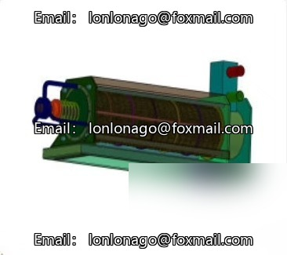

# Fluid slurry tray separator: a device widely applied in industrial fields, having

## Body

Spiral sleeving-discharge settling centrifugal machine: It is a device widely used in industrial fields, featuring features such as compact structure, easy closing, smooth operation, low noise, large processing capacity, low energy consumption, high automation degree, low labor intensity, and convenient operation and maintenance.

The device is widely used in industrial fields and has features including compact structure, easy sealing, smooth operation, low noise, large handling capacity, low energy consumption, high automation level, small labor intensity, and convenient operation and maintenance.

<!-- AI_ENRICHED -->

## Images

## Payment

Here is a pay link on Stripe ( https://buy.stripe.com/3cs8yP7sY87d0vu9AB ). Please contact me lonlonago@foxmail.com after funding $89, and I will send you a complete data files , thank you!

